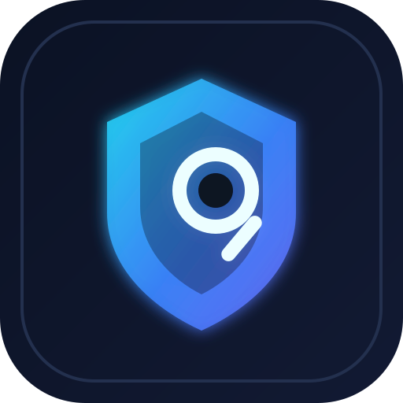

<p align="center">
  
</p>

<h1 align="center">Brauser — Sandbox Lab Browser</h1>

<p align="center">
  <b>EN:</b> A browser, a security lab and a sandbox in one window. Check the site — then trust it.<br/>
  <b>RU:</b> Браузер, лаборатория безопасности и песочница в одном окне. Проверяй сайт — потом доверяй.
</p>

<p align="center">
  
</p>

<p align="center">
  <a href="#english">English</a> · <a href="#русский">Русский</a>
</p>

---

## English

**Brauser** is a desktop browser (Electron + Chromium) with a built-in security laboratory. You open a website as usual, browse it in an isolated sandbox session, press one button and get a clear verdict: can you trust this site, register there and enter personal data?

The whole interface is available in **English and Russian**. Switch the language in the top-right corner of the window (**Language → RU / EN**). The choice is saved, and scan findings are written in the selected language too.

### What it checks

| Module | What it looks for |
| --- | --- |
| Site engine | CMS and stack (WordPress, XenForo, Bitrix, Joomla, etc.), exposed version |
| TLS / Certificate | Protocol, validity, expiry, self-signed or broken certificates |
| Headers | CSP, HSTS, X-Frame-Options, X-Content-Type-Options, Referrer-Policy, CORS |
| Cookies | Missing `Secure`, `HttpOnly`, `SameSite` flags |
| XSS (reflected) | Parameters that reflect input back unescaped |
| SQL injection | Database errors and behaviour changes on test payloads |
| Open ports | Service ports reachable from the internet (DB, FTP, SSH, admin tools) |
| Admin / login | Admin panels and login pages visible to anyone, CMS-aware paths |
| Exposed files | `.env`, `.git`, backups, configs, directory listings |

### Key features
- **Trust score 0–100** and a verdict: *Safe*, *With caution*, *Dangerous*, *Do not trust*.
- **Beginner-friendly findings**: exact path, where to look, evidence, why it is dangerous and step-by-step fix. Click a path to copy it.
- **Crawl mode for XSS / SQL**: browse the site or press *Collect links*, then the scanner checks up to 12 pages, not just the home page.
- **Tabs with isolated reports**: every tab keeps its own scan results, so reports from different sites never mix.
- **No auto-scan**: nothing is sent until you press the button. Module results are cached, so clicking a module shows them instantly.
- **Passes anti-bot pages**: scans reuse the browser session, so sites behind JS challenges (DDoS filters, Cloudflare) are analysed correctly.
- **RU / EN interface**: a full translation of the UI, verdicts, audit log and scanner findings.
- Dark laboratory design, live audit log, custom dark title bar.

### Quick start
```bash
git clone -b sandbox-lab-browser https://github.com/EcosReward/Brauser.git
cd Brauser
npm install
npm start
```
Requirements: Node.js 18+ and Windows, macOS or Linux.

### How to use
1. Pick the interface language in the top-right corner (RU / EN).
2. Enter a site address and press **Open**.
3. Optionally browse a few pages or press **Collect links**.
4. Press **Full security check**.
5. Read the verdict and the findings, then fix the issues on your site step by step.

Hotkeys: `Ctrl+T` opens a new tab, `Ctrl+W` closes the tab, `Ctrl+L` focuses the address bar.

### Project structure
```
main.js         Electron main process, window, IPC, session HTTP client
preload.js      Safe bridge between UI and scanners
scanners.js     All security checks and verdict calculation
i18n.js         Re-export of the shared dictionary for Node
src/i18n.js     RU / EN dictionaries (UI + scanners)
src/index.html  Interface layout
src/renderer.js Tabs, UI logic, reports
src/styles.css  Laboratory theme
docs/           Promo texts and images
```

More promo copy: [`docs/PROMO_EN.md`](docs/PROMO_EN.md)

---

## Русский

**Brauser** — десктопный браузер (Electron + Chromium) со встроенной лабораторией безопасности. Вы открываете сайт как обычно, гуляете по нему в изолированной песочнице, нажимаете одну кнопку и получаете понятный вердикт: можно ли доверять сайту, регистрироваться и вводить личные данные.

Весь интерфейс доступен **на русском и английском**. Язык переключается в правом верхнем углу окна (**Язык → RU / EN**). Выбор сохраняется, а находки сканеров тоже выводятся на выбранном языке.

<p align="center">
  
</p>

### Что проверяется

| Модуль | Что ищет |
| --- | --- |
| Движок сайта | CMS и технологии (WordPress, XenForo, Bitrix, Joomla и др.), раскрытая версия |
| TLS / Сертификат | Протокол, валидность, срок действия, самоподписанные и битые сертификаты |
| Заголовки | CSP, HSTS, X-Frame-Options, X-Content-Type-Options, Referrer-Policy, CORS |
| Cookie | Отсутствие флагов `Secure`, `HttpOnly`, `SameSite` |
| XSS (отражённый) | Параметры, которые возвращают ввод без экранирования |
| SQL-инъекции | Ошибки БД и изменение поведения на тестовых запросах |
| Открытые порты | Служебные порты, доступные из интернета (БД, FTP, SSH, панели) |
| Админка / вход | Админ-панели и страницы входа, видимые всем, с учётом путей CMS |
| Открытые файлы | `.env`, `.git`, бэкапы, конфиги, листинг каталогов |

### Главное
- **Индекс доверия 0–100** и вердикт: *Безопасно*, *С осторожностью*, *Опасно*, *Не доверять*.
- **Понятные находки для новичка**: точный путь, где искать, доказательство, чем опасно и что сделать по шагам. Клик по пути копирует его.
- **Режим обхода для XSS / SQL**: погуляйте по сайту или нажмите «Собрать ссылки» — сканер проверит до 12 страниц, а не только главную.
- **Вкладки с отдельными отчётами**: у каждой вкладки свои результаты, отчёты разных сайтов не смешиваются.
- **Без автопроверки**: ничего не отправляется, пока вы не нажмёте кнопку. Результаты модулей кэшируются и показываются мгновенно.
- **Проходит антибот-страницы**: проверки используют сессию браузера, поэтому сайты за JS-челленджами (DDoS-фильтры, Cloudflare) анализируются корректно.
- **Интерфейс RU / EN**: полностью переведены интерфейс, вердикты, журнал аудита и находки сканеров.
- Тёмный дизайн лаборатории, живой журнал аудита, тёмная строка заголовка.

### Быстрый старт
```bash
git clone -b sandbox-lab-browser https://github.com/EcosReward/Brauser.git
cd Brauser
npm install
npm start
```
Нужно: Node.js 18+ и Windows, macOS или Linux.

### Как пользоваться
1. Выберите язык интерфейса в правом верхнем углу (RU / EN).
2. Введите адрес сайта и нажмите **Открыть**.
3. При желании пройдитесь по страницам или нажмите **Собрать ссылки**.
4. Нажмите **Полная проверка безопасности**.
5. Прочитайте вердикт и находки, затем исправьте проблемы на своём сайте по шагам.

Горячие клавиши: `Ctrl+T` — новая вкладка, `Ctrl+W` — закрыть вкладку, `Ctrl+L` — адресная строка.

Подробный рекламный текст: [`docs/PROMO_RU.md`](docs/PROMO_RU.md)

---

## Important / Важно

Active checks send real test requests. Use them only on sites you own or have written permission to test.

Активные проверки отправляют настоящие тестовые запросы. Используйте их только на своих сайтах или с письменного разрешения владельца.

## License

MIT
